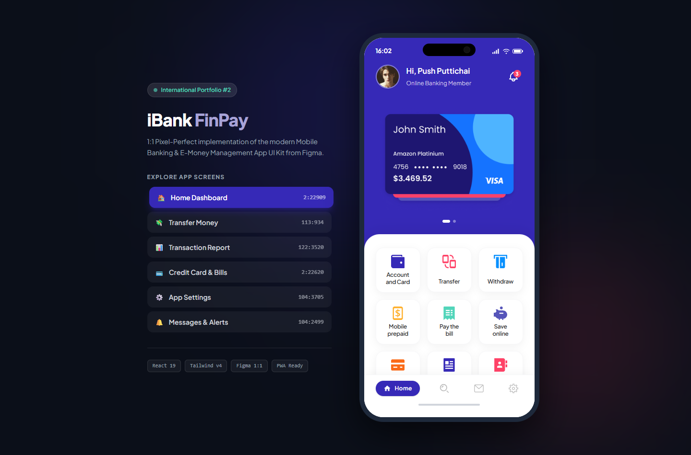
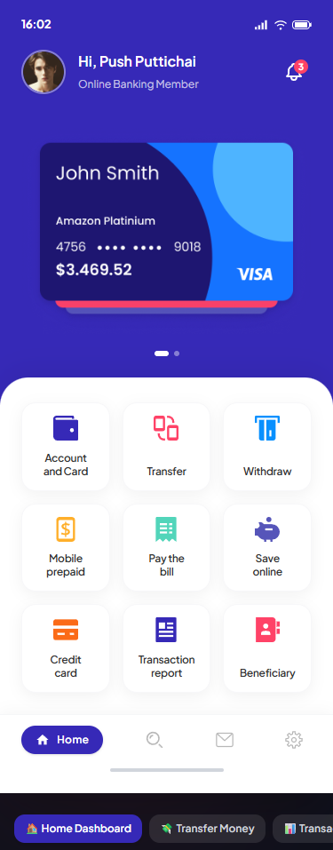
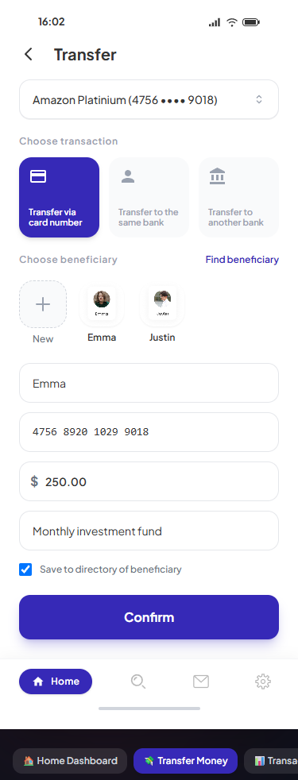
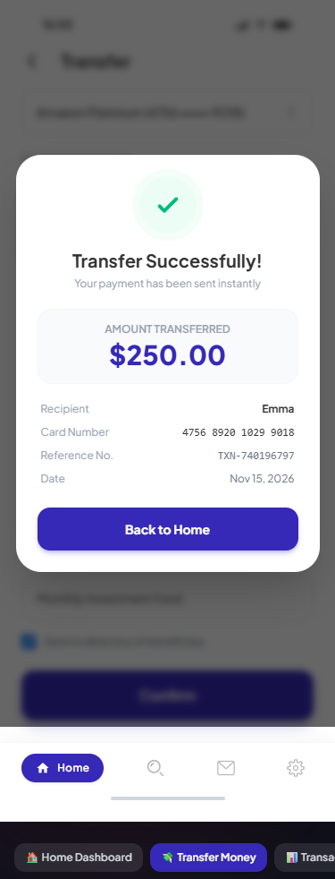
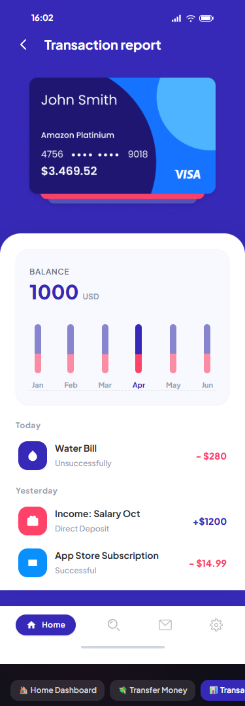
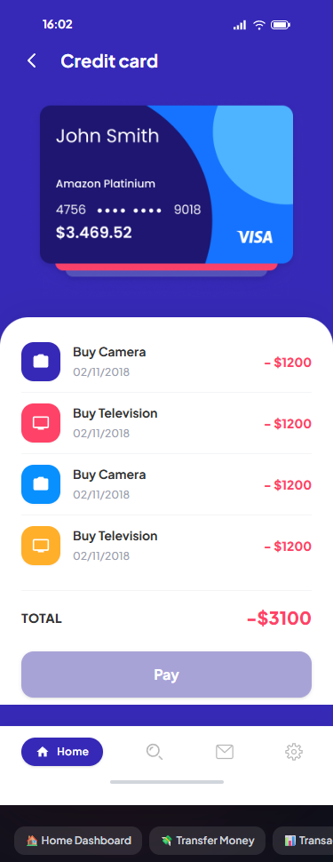
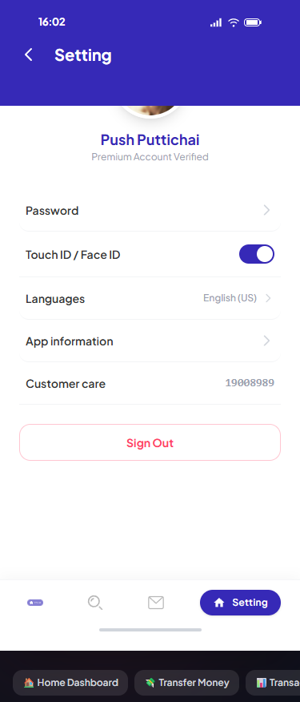

# 💳 NovaBank — Modern Mobile Banking & E-Money App

> **International Portfolio Showcase #2**  
> 1:1 Pixel-Perfect Implementation of a **Modern Mobile Banking UI Kit** built with **React 19**, **Vite**, and **Tailwind CSS v4**.



[](https://react.dev/)
[](https://tailwindcss.com/)
[](https://vitejs.dev/)
[](https://opensource.org/licenses/MIT)

---

## 📱 Interactive Multi-Screen Experience

This application features an interactive **Device Frame Simulator** on desktop and operates as a seamless **full-screen native web app** on mobile devices.

| 🏠 Home Dashboard | 💸 Money Transfer | 🧾 Transfer Success Receipt |
| :---: | :---: | :---: |
|  |  |  |

| 📊 Transaction Report | 💳 Credit Card & Bills | ⚙️ Settings & Biometrics |
| :---: | :---: | :---: |
|  |  |  |

---

## 🌟 Key Features

1. **Dashboard**:
   - Clean profile header with member status badge and notification center.
   - Interactive bank card stack with 3D layered depth and balance display.
   - 3x3 category grid:
     - Account and Card
     - Transfer (direct screen routing)
     - Withdraw (with interactive bottom sheet modal)
     - Mobile prepaid (with interactive recharge modal)
     - Pay the bill
     - Save online
     - Credit card (with expense breakdown)
     - Transaction report (with interactive monthly charts)
     - Beneficiary directory
2. **Transfer Flow**:
   - Card selector dropdown
   - 3 transaction type selectors (Card number, Same bank, Other bank)
   - Beneficiary quick avatars (+ Add new)
   - Real-time form validation and live success receipt modal with transaction reference.
3. **Transaction Report & Analytics**:
   - Real-time balance counter
   - Interactive 6-month spending chart with gradient bars and monthly selection.
   - Itemized transaction feed with water bill, salary income, and subscriptions.
4. **Card Detail & Expenses**:
   - Detailed card view with itemized purchases.
   - Total calculation and interactive payment confirmation.
5. **Settings & Biometrics**:
   - User profile management
   - Interactive Touch ID / Face ID toggle switch
   - Language selector and customer service hotline.
6. **Bottom Tab Bar**:
   - Persistent iOS floating navigation bar with active indigo pill and tab routing.

---

## 🎨 Design Tokens & Specs

- **Primary 1 (Signature Indigo)**: `#3629B7`
- **Primary 2**: `#5655B9`
- **Primary 3**: `#A8A3D7`
- **Primary 4 (Canvas / BG)**: `#F2F1F9`
- **Neutral Dark**: `#343434`
- **Neutral Grey**: `#898989`
- **Semantic Coral (Alerts / Negatives)**: `#FF4267`
- **Semantic Cyan**: `#0890FE`
- **Semantic Amber**: `#FFAF2A`
- **Semantic Teal**: `#52D5BA`
- **Typography**: Plus Jakarta Sans & Inter

---

## 🚀 Getting Started

### Prerequisites
- Node.js (v18+)
- npm or yarn

### Installation
```bash
# Clone the repository
git clone https://github.com/lxlnimalxl/novabank-mobile-banking-app.git

# Enter project directory
cd novabank-mobile-banking-app

# Install dependencies
npm install

# Start development server
npm run dev
```

### Production Build
```bash
npm run build
npm run preview
```

---

## 📄 License
Released under the [MIT License](./LICENSE).
